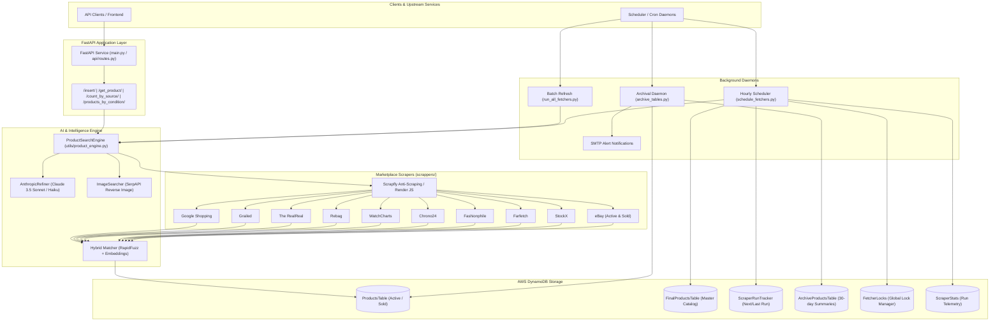

# Price Scrapper

> **Enterprise-Grade Distributed Multi-Marketplace Web Scraping & AI-Assisted Price Aggregation Engine**

[](https://www.python.org/)
[](https://fastapi.tiangolo.com)
[](https://aws.amazon.com/dynamodb/)
[](https://www.anthropic.com/)
[](https://scrapfly.io/)
[](LICENSE)

---

## Table of Contents

- [Overview](#overview)
- [Key Features](#key-features)
- [System Architecture](#system-architecture)
- [Project Directory Structure](#project-directory-structure)
- [Supported Marketplaces & Thresholds](#supported-marketplaces--thresholds)
- [Prerequisites & Installation](#prerequisites--installation)
- [Environment Configuration](#environment-configuration)
- [DynamoDB Database Schema](#dynamodb-database-schema)
- [REST API Reference](#rest-api-reference)
  - [1. Search & Ingest (`POST /insert/`)](#1-search--ingest-post-insert)
  - [2. Query Products (`POST /get_product/`)](#2-query-products-post-get_product)
  - [3. Count by Source (`GET /count_by_source/`)](#3-count-by-source-get-count_by_source)
  - [4. Filter by Condition (`GET /products_by_condition/`)](#4-filter-by-condition-get-products_by_condition)
  - [5. Missing Products Audit (`GET /missing-products`)](#5-missing-products-audit-get-missing-products)
- [Batch Scripts & Schedulers](#batch-scripts--schedulers)
  - [Continuous Hourly Scheduler](#continuous-hourly-scheduler)
  - [Run All Fetchers Concurrently](#run-all-fetchers-concurrently)
  - [Automated 30-Day Archival Pipeline](#automated-30-day-archival-pipeline)
  - [Table Management Utility](#table-management-utility)
- [Adding a New Scraper](#adding-a-new-scraper)
- [Production Deployment & Runbook](#production-deployment--runbook)
- [Security & Best Practices](#security--best-practices)
- [Author & Maintenance](#author--maintenance)

---

## Overview

**Price Scrapper** is an asynchronous, distributed data extraction and price intelligence engine designed to aggregate, analyze, and track product pricing across 13+ global secondary marketplaces for luxury goods, streetwear, sneakers, fine jewelry, and luxury watches.

The system combines:
1. **High-concurrency web scraping** powered by Scrapfly (with headless browser rendering, proxy rotation, and anti-scraping bypass).
2. **Reverse image discovery** using SerpAPI Google Lens / Reverse Image engine to locate products by image.
3. **AI query refinement and semantic validation** using Anthropic Claude to infer product attributes, sizes, conditions, and geographic locations.
4. **Hybrid similarity scoring** blending RapidFuzz string distance and SentenceTransformers semantic embeddings to filter out scraping false positives.
5. **Serverless persistence and state management** on AWS DynamoDB, featuring distributed locking, continuous scheduled monitoring, and automated 30-day price archival.

---

## Key Features

- **Multi-Marketplace Coverage:** Out-of-the-box support for eBay, StockX, Farfetch, Fashionphile, Chrono24, WatchCharts, Rebag, The RealReal, Grailed, Google Shopping, SerpAPI, Flight Club, GOAT, and Vestiaire Collective.
- **Asynchronous & High-Throughput:** Built on Python's `asyncio` and `aiohttp`/`httpx` primitives with configurable concurrency semaphores per marketplace to maximize throughput without exceeding rate limits.
- **AI-Powered Query Refinement:** Leverages the Anthropic Claude API to expand fuzzy search queries, extract normalized sizes (shoes/apparel), standardize condition ratings, and resolve seller locations.
- **Visual Product Discovery:** Reverse image search integration via SerpAPI, enabling search by product image URL.
- **Dual-Layer Similarity Filter:** Employs a weighted combination of RapidFuzz token matching and SentenceTransformers neural embeddings to ensure listings match the target product above per-marketplace threshold boundaries.
- **Distributed State & Concurrency Control:** Uses DynamoDB-backed distributed locks (`FetcherLocks`) to prevent concurrent task collision and duplicate runs.
- **Automated Lifecycle & Archival:** Runs a continuous scheduler with configurable scraping intervals per marketplace and executes daily automated 30-day data archival into aggregated historical average price records.
- **Real-Time API & Batch Daemons:** Exposes a clean FastAPI REST interface for on-demand search and queries, alongside background daemons for scheduled scraping and monitoring.

---

## System Architecture



---

## Project Directory Structure

```
Price-Scrapper/
├── api/
│   ├── __init__.py
│   └── routes.py                      # FastAPI route definitions and endpoint handlers
│
├── config/
│   ├── __init__.py
│   ├── aws.py                         # AWS DynamoDB credentials and table name mappings
│   ├── email.py                       # SMTP notification configuration
│   ├── scrapper_config.py             # Scrapfly, SerpAPI, and Gemini API keys
│   └── scrapping_tracker_config.py    # Marketplace scraping frequency intervals (in hours)
│
├── fetch_scripts/                     # Asynchronous batch runners per marketplace
│   ├── __init__.py
│   ├── fetch_ebay.py
│   ├── fetch_farfetch.py
│   ├── fetch_fashionphile.py
│   ├── fetch_google.py
│   ├── fetch_rebag.py
│   └── fetch_stockx.py
│
├── models/                            # Domain entity data models
│   ├── __init__.py
│   └── product_item.py                # Standardized product dictionary builder
│
├── schemas/                           # Pydantic validation schemas
│   ├── __init__.py
│   ├── productId_input.py             # Schema for ID-based lookups and filters
│   ├── product_item.py                # Schema for product payload representation
│   └── search_input.py                # Schema for search and insertion requests
│
├── scrappers/                         # Marketplace-specific scraping implementations
│   ├── __init__.py
│   ├── chrono24.py                    # Chrono24 luxury watch scraper
│   ├── ebay.py                        # eBay active and sold listings scraper
│   ├── farfetch.py                    # Farfetch luxury fashion scraper
│   ├── fashionphile.py                # Fashionphile pre-owned luxury handbag scraper
│   ├── flightclub.py                  # Flight Club sneaker scraper
│   ├── goat.py                        # GOAT marketplace scraper
│   ├── google_shopping.py             # Google Shopping scraper
│   ├── grailed.py                     # Grailed designer and streetwear scraper
│   ├── realreal.py                    # The RealReal luxury consignment scraper
│   ├── rebag.py                       # Rebag designer handbag and watch scraper
│   ├── serp.py                        # SerpAPI Google search scraper
│   ├── stockx.py                      # StockX market data scraper
│   ├── vestiaire.py                   # Vestiaire Collective luxury fashion scraper
│   └── watchcharts.py                 # WatchCharts market index scraper
│
├── utils/                             # Core utilities and helper modules
│   ├── __init__.py
│   ├── antropic.py                    # Anthropic Claude AI refiner for query & metadata extraction
│   ├── database.py                    # DynamoDB deduplication and existence check helpers
│   ├── email.py                       # SMTP alert dispatch module
│   ├── global_lock.py                 # Distributed lock manager backed by DynamoDB
│   ├── image_search.py                # SerpAPI reverse image search utility
│   ├── logger.py                      # Per-scraper daily rotating logger
│   ├── product_engine.py              # Central search orchestrator and multi-source aggregator
│   └── utility.py                     # Dual-layer fuzzy string + semantic embedding matcher
│
├── archive_tables.py                  # Daily maintenance job: 30-day price archival & rollup
├── main.py                            # FastAPI application entrypoint
├── requirements.txt                   # Project Python dependencies
├── requirement.txt                    # Project Python dependencies (alias)
├── run_all_fetchers.py                # Parallel batch fetcher across all supported platforms
├── run_engine.py                      # Alternative one-product-across-all-scrapers runner
├── schedule_fetchers.py               # Continuous hourly background scheduler daemon
├── tables.py                          # DynamoDB schema creation and table management CLI
├── .env.example                       # Template for environment variables
└── README.md                          # Comprehensive project documentation
```

---

## Supported Marketplaces & Thresholds

To eliminate noise, counterfeit titles, and false positives, every candidate listing is evaluated against a **hybrid similarity score**:

$$\text{Combined Score} = (0.5 \times \text{RapidFuzz WRatio}) + (0.5 \times \text{SentenceTransformer Cosine Similarity})$$

A candidate listing is accepted only if $\text{Combined Score} \ge \text{Threshold}$.

| Marketplace | Category Focus | Scraping Mechanism | Concurrency | Threshold Limit |
|---|---|---|---|---|
| **eBay** | Multi-category, Sneaker, Luxury | Scrapfly HTML + JS Render (Active & Sold) | Medium | `0.80` |
| **StockX** | Sneakers, Streetwear, Collectibles | Scrapfly JSON / REST API | High | `0.70` |
| **Farfetch** | Luxury Apparel, Shoes, Handbags | Scrapfly HTML Parser | Medium | `0.84` |
| **Fashionphile** | Ultra-luxury Handbags, Jewelry | Scrapfly HTML Parser | Medium | `0.60` |
| **Rebag** | Designer Bags, Watches, Fine Jewelry | Scrapfly HTML / API | Medium | `0.70` |
| **The RealReal** | Luxury Consignment Fashion | Scrapfly HTML Parser | Medium | `0.80` |
| **Chrono24** | Luxury & Vintage Watches | Scrapfly HTML Parser | Low | `0.75` |
| **WatchCharts** | Watch Market Indices & Transactions | Scrapfly HTML Parser | Low | `0.70` |
| **Grailed** | Menswear, Archival Streetwear | Scrapfly HTML Parser | Medium | `0.75` |
| **Google Shopping** | Broad Aggregated E-Commerce | SerpAPI / Scrapfly | Medium | `0.75` |
| **Flight Club** | Footwear & Sneakers | Direct / Scrapfly | Medium | `0.75` |
| **GOAT** | Sneakers & Apparel | Direct / Scrapfly | Medium | `0.75` |
| **Vestiaire Collective** | European & US Pre-Owned Luxury | Scrapfly HTML Parser | Medium | `0.70` |

---

## Prerequisites & Installation

### Prerequisites

- **Python 3.12+** (tested with Python 3.12, 3.13, and 3.14)
- **AWS Account** with DynamoDB read/write permissions
- **Scrapfly API Account** (for web scraping proxy & anti-bot bypass)
- **Anthropic Claude API Key** (for query refinement & metadata extraction)
- **SerpAPI Key** (optional, for reverse image search and Google Shopping)

### Installation Steps

1. **Clone the repository:**
   ```bash
   git clone https://github.com/Kunal-63/Price-Scrapping.git
   cd Price-Scrapping
   ```

2. **Create and activate a virtual environment:**
   ```bash
   # Linux / macOS
   python3 -m venv venv
   source venv/bin/activate

   # Windows (PowerShell)
   python -m venv venv
   .\venv\Scripts\Activate.ps1
   ```

3. **Install project dependencies:**
   ```bash
   pip install --upgrade pip
   pip install -r requirements.txt
   ```

4. **Initialize DynamoDB Tables:**
   Make sure your AWS credentials are configured, then create the required DynamoDB tables:
   ```bash
   python tables.py
   ```

5. **Start the FastAPI Application:**
   ```bash
   uvicorn main:app --host 0.0.0.0 --port 8000 --reload
   ```
   The interactive API documentation will be available at `http://localhost:8000/docs`.

---

## Environment Configuration

Copy `.env.example` to `.env` or set the variables in your execution environment:

```bash
cp .env.example .env
```

| Variable | Description | Default | Required? |
|---|---|---|---|
| `ANTHROPIC_API_KEY` | Anthropic Claude API Key for query refinement & extraction | *None* | **Yes** |
| `SCRAPFLY_KEY` | Scrapfly API key for web scraping & proxy rotation | *None* | **Yes** |
| `SERPAPI_KEY` | SerpAPI key for Google Reverse Image & Shopping | *None* | Optional |
| `AWS_ACCESS_KEY_ID` | AWS IAM Access Key ID | *None* | **Yes** |
| `AWS_SECRET_ACCESS_KEY` | AWS IAM Secret Access Key | *None* | **Yes** |
| `AWS_REGION` | AWS Region hosting the DynamoDB tables | `us-east-1` | No |
| `PRODUCT_TABLE` | Main product listings DynamoDB table | `ProductsTable` | No |
| `SCRAPER_TRACKING_TABLE`| Tracking table for scheduled runs per product | `ScraperRunTracker` | No |
| `FINAL_PRODUCT_TABLE` | Master catalog table of products to track | `FinalProductsTable`| No |
| `ARCHIVE_PRODUCTS_TABLE`| 30-day historical average price table | `ArchiveProductsTable`| No |
| `FETCHERS_LOCK_TABLE` | Distributed locks table | `FetcherLocks` | No |
| `SCRAPER_STATS_TABLE` | Telemetry & execution statistics table | `ScraperStats` | No |
| `EMAIL_HOST` | SMTP server host | `smtp.gmail.com` | No |
| `EMAIL_PORT` | SMTP server port | `587` | No |
| `EMAIL_USER` | SMTP username / sender email | *None* | No |
| `EMAIL_PASS` | SMTP application password | *None* | No |
| `EMAIL_TO` | Alert recipient email address | *None* | No |

---

## DynamoDB Database Schema

The engine relies on six structured DynamoDB tables:

### 1. `ProductsTable` (Main Product Listings)
Stores scraped active and sold product records from all platforms.
- **Partition Key:** `Id` (`String`, composite hash of listing URL + date)
- **Global Secondary Index (GSI):** `product_id-index` on `product_id` for fast product-level queries.

| Attribute | Type | Description |
|---|---|---|
| `Id` | String | Primary Key (URL + Date identifier) |
| `product_id` | String | Master catalog product identifier (GSI) |
| `title` | String | Extracted product title from marketplace |
| `listing_price` | Number | Normalized price in numeric format |
| `currency` | String | Currency code (e.g., `USD`, `EUR`) |
| `url` | String | Canonical URL of the listing |
| `image_url` | String | Direct URL of the primary product image |
| `condition` | String | Item condition (e.g., `New`, `Pre-owned`, `Excellent`) |
| `seller` | String | Marketplace seller name or store username |
| `location` | String | Item or seller geographical location |
| `top_rated` | Boolean| Flag indicating if the seller has top-rated status |
| `source` | String | Marketplace source identifier (`ebay`, `stockx`, etc.) |
| `size` | String | Normalized item size extracted by Claude AI |
| `category` | String | Category classification (e.g., `sneakers`, `handbags`) |
| `is_sold` | Boolean| Indicates if the listing represents a completed/sold transaction |
| `created_at` | String | ISO 8601 creation timestamp |

### 2. `ScraperRunTracker` (Interval Scheduling State)
Coordinates when each product was last crawled and when the next scrape is due.
- **Partition Key:** `product_id` (`String`)
- **Sort Key:** `source` (`String`)

| Attribute | Type | Description |
|---|---|---|
| `product_id` | String | Product ID |
| `source` | String | Marketplace source identifier |
| `last_run` | String | Timestamp of the most recent scrape execution |
| `next_run` | String | Timestamp when the scraper is next eligible to execute |

### 3. `FinalProductsTable` (Master Catalog)
Contains the master catalog of items targeted for price monitoring.
- **Partition Key:** `product_id` (`String`)

### 4. `ArchiveProductsTable` (30-Day Historical Summaries)
Stores aggregated average pricing per product and source calculated across 30-day windows.
- **Partition Key:** `product_id` (`String`)

| Attribute | Type | Description |
|---|---|---|
| `product_id` | String | Product ID |
| `Date` | Map | Dictionary mapping dates to average price per marketplace |

### 5. `FetcherLocks` (Distributed Lock Manager)
Coordinates execution across workers to prevent concurrent scraping tasks on the same target.
- **Partition Key:** `task_id` (`String`)

| Attribute | Type | Description |
|---|---|---|
| `task_id` | String | Lock identifier (e.g., `global_fetcher_lock`) |
| `locked_at` | String | Timestamp when the lock was acquired |
| `expires_at` | String | Lock expiration timestamp (TTL safety) |
| `script_name` | String | Script name that acquired the lock |
| `status` | String | Status (`LOCKED`, `COMPLETED`, `FAILED`) |
| `time_taken` | Number | Execution duration in seconds |

### 6. `ScraperStats` (Telemetry & Performance Metrics)
Records execution telemetry for analytics and monitoring.
- **Partition Key:** `Source` (`String`)
- **Sort Key:** `run_id` (`String`)

| Attribute | Type | Description |
|---|---|---|
| `Source` | String | Scraper platform identifier |
| `run_id` | String | Unique run identifier (UUID) |
| `products_ran` | Number | Count of products processed during the run |
| `total_results` | Number | Total listings extracted |
| `total_active` | Number | Total active listings found |
| `total_sold` | Number | Total sold/completed listings found |
| `time_taken` | Number | Run execution duration in seconds |
| `timestamp` | String | ISO 8601 run completion timestamp |

---

## REST API Reference

### 1. Search & Ingest (`POST /insert/`)

Initiates a multi-marketplace real-time search for a product (via text query or reverse image search), filters listings using similarity thresholds, and saves valid results to DynamoDB.

**Request:**
```http
POST /insert/
Content-Type: application/json

{
  "query": "Jordan 1 Retro High OG Chicago Lost and Found",
  "category": "sneakers",
  "product_id": "prod_jordan_chicago_01",
  "image_url": "https://example.com/chicago.jpg"
}
```

**Response (`200 OK`):**
```json
{
  "time_taken_seconds": 3.84,
  "result_count": 18,
  "results": [
    {
      "title": "Nike Air Jordan 1 Retro High OG Chicago Lost & Found DZ5485-612",
      "listing_price": 285.0,
      "currency": "USD",
      "url": "https://www.ebay.com/itm/...",
      "image_url": "https://i.ebayimg.com/...",
      "condition": "New with box",
      "seller": "kicks_vault",
      "location": "United States",
      "top_rated": true,
      "source": "ebay",
      "size": "10.5",
      "category": "sneakers"
    }
  ]
}
```

---

### 2. Query Products (`POST /get_product/`)

Retrieves product listings from DynamoDB by product ID or query, with support for price range filtering, sorting, source grouping, and pagination.

**Request:**
```http
POST /get_product/
Content-Type: application/json

{
  "product_id": "prod_jordan_chicago_01",
  "filters": {
    "min_price": "200",
    "max_price": "500"
  },
  "limit": 10,
  "sort_by": "listing_price",
  "sort_order": "asc",
  "group_by": "source"
}
```

**Response (`200 OK`):**
```json
{
  "results": [
    {
      "product": {
        "Id": "a1b2c3d4...",
        "product_id": "prod_jordan_chicago_01",
        "title": "Air Jordan 1 Retro High Chicago Lost and Found",
        "listing_price": 275.0,
        "currency": "USD",
        "source": "stockx",
        "condition": "New",
        "size": "10"
      },
      "score": 96
    }
  ],
  "last_evaluated_key": null,
  "total_count": 1,
  "message": "Products retrieved successfully"
}
```

---

### 3. Count by Source (`GET /count_by_source/`)

Returns inventory distribution across marketplaces for a given product or all tracked products.

**Request:**
```http
GET /count_by_source/?product_id=prod_jordan_chicago_01
```

**Response (`200 OK`):**
```json
{
  "product_source_counts": {
    "prod_jordan_chicago_01": {
      "ebay": 42,
      "stockx": 8,
      "flightclub": 5,
      "goat": 12
    }
  }
}
```

---

### 4. Filter by Condition (`GET /products_by_condition/`)

Retrieves listings matching a specified condition (e.g., `New`, `Pre-owned`, `Excellent`).

**Request:**
```http
GET /products_by_condition/?condition=New
```

**Response (`200 OK`):**
```json
{
  "results": [
    {
      "product": {
        "title": "Rolex Submariner Date 126610LN",
        "listing_price": 14200.0,
        "source": "chrono24",
        "condition": "New"
      },
      "score": 100
    }
  ]
}
```

---

### 5. Missing Products Audit (`GET /missing-products`)

Performs an audit between `ProductsTable` and `FinalProductsTable` to identify master catalog items that currently have no scraped records.

**Request:**
```http
GET /missing-products
```

**Response (`200 OK`):**
```json
[
  "prod_rolex_daytona_116500",
  "prod_hermes_birkin_25_epsom",
  "prod_audemars_royal_oak_15500"
]
```

---

## Batch Scripts & Schedulers

### Continuous Hourly Scheduler

Runs continuously in the background to scrape products due for updates based on the intervals configured in `config/scrapping_tracker_config.py`.

```bash
python schedule_fetchers.py
```

**How it works:**
1. Queries `ScraperRunTracker` for records where `next_run <= current_timestamp`.
2. Resolves product metadata from `FinalProductsTable`.
3. Groups overdue tasks by source marketplace.
4. Executes platform fetchers asynchronously with semaphore-managed concurrency.
5. Updates `ScraperRunTracker` with the new `next_run` timestamp.
6. Dispatches an SMTP summary report upon completion.

### Run All Fetchers Concurrently

Manually triggers an immediate, full-sweep refresh across all marketplaces:

```bash
python run_all_fetchers.py
```

### Automated 30-Day Archival Pipeline

Maintains database performance by rolling up listings older than 30 days:

```bash
python archive_tables.py
```

**Workflow:**
- Scans `ProductsTable` for items created more than 30 days ago.
- Computes daily average prices grouped by `product_id` and `source`.
- Persists summarized records into `ArchiveProductsTable`.
- Deletes archived raw items from `ProductsTable`.
- Sends an email summary report to the administrator.

### Table Management Utility

```bash
# Create all DynamoDB tables if they don't already exist
python tables.py

# To inspect or delete table records during development, invoke helpers in tables.py
```

---

## Adding a New Scraper

To integrate a new marketplace (e.g., `Grailed` or `Poshmark`):

1. **Create the Scraper Class:**
   Create `scrappers/newmarket.py` inheriting standard patterns:
   ```python
   class NewMarketScraper:
       def __init__(self, concurrency=5):
           self.semaphore = asyncio.Semaphore(concurrency)

       async def search(self, query: str, category: str = None) -> list:
           # 1. Build search URL and request Scrapfly proxy
           # 2. Parse HTML / JSON response with BeautifulSoup or json.loads
           # 3. Construct ProductItem model
           # 4. Filter using combined_similarity(title, query, threshold=0.75)
           # 5. Insert valid items into ProductsTable
           return results
   ```

2. **Add a Batch Fetcher Script:**
   Create `fetch_scripts/fetch_newmarket.py` extending the batch fetcher pattern with pagination, tracker updates, and telemetry logging.

3. **Register in Product Engine:**
   Import and register the scraper inside `utils/product_engine.py` in `ProductSearchEngine.search()`.

4. **Configure Threshold & Scheduling:**
   - Define the similarity threshold limit in `utils/utility.py`.
   - Set the scrape interval in `config/scrapping_tracker_config.py`.

---

## Production Deployment & Runbook

### Deployment on AWS EC2 (Ubuntu / Amazon Linux)

1. **System Packages:**
   ```bash
   sudo apt-get update && sudo apt-get install -y python3-pip python3-venv tmux git
   ```

2. **Clone & Setup:**
   ```bash
   git clone https://github.com/Kunal-63/Price-Scrapping.git
   cd Price-Scrapping
   python3 -m venv venv
   source venv/bin/activate
   pip install -r requirements.txt
   ```

3. **Configure Environment:**
   Create `.env` with your production API keys and AWS IAM credentials.

4. **Running with tmux:**
   ```bash
   # Start API server in tmux
   tmux new -s price_api
   uvicorn main:app --host 0.0.0.0 --port 8000 --workers 4
   # Press Ctrl+B, then D to detach

   # Start Scheduler Daemon in tmux
   tmux new -s price_scheduler
   python schedule_fetchers.py
   # Press Ctrl+B, then D to detach
   ```

5. **Cron Configuration for 30-Day Archival:**
   Add to `crontab -e`:
   ```cron
   # Run 30-day archival daily at 2:00 AM
   0 2 * * * cd /home/ubuntu/Price-Scrapping && /home/ubuntu/Price-Scrapping/venv/bin/python archive_tables.py >> /var/log/price_archive.log 2>&1
   ```

6. **Log Monitoring:**
   Daily rotating log files are saved to `logs/` (e.g., `logs/ebay_scrapper.log`, `logs/stockx_scrapper.log`).

---

## Security & Best Practices

- **Never Commit Secrets:** Store all API keys (`ANTHROPIC_API_KEY`, `SCRAPFLY_KEY`, AWS credentials) in environment variables or an isolated `.env` file that is excluded in `.gitignore`.
- **Anti-Scraping Compliance:** Always leverage Scrapfly's proxy rotation and respect per-marketplace rate limits to prevent IP blocks.
- **Concurrency Safeguards:** Keep concurrency semaphores bounded (`5` to `20`) to prevent local socket exhaustion and proxy throttling.
- **Data Deduplication:** `utils/database.py` enforces per-day URL deduplication to avoid redundant writes into DynamoDB.

---

## Author & Maintenance

Maintained by **[Kunal Adwani](https://github.com/Kunal-63)**.

- **GitHub:** [@Kunal-63](https://github.com/Kunal-63)
- **Repository:** [https://github.com/Kunal-63/Price-Scrapping](https://github.com/Kunal-63/Price-Scrapping)
